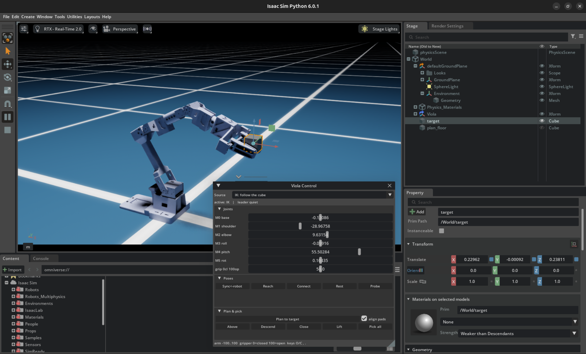

# StarAI Viola in Isaac Sim

The StarAI Viola is a 6-axis desktop arm with a gripper, sold by Seeed Studio. This repo puts it into
NVIDIA Isaac Sim 6.0.1 with a control panel. You get a slider for each joint, a target cube you drag
for inverse kinematics, and collision-free planning with cuMotion, up to a full pick sequence.



It runs without the arm. It needs Isaac Sim and an RTX GPU.

The cube is a target marker with no physics. The pick sequence moves the gripper through the pick,
and the cube stays where it is.

## What's in here

I didn't write the IK solver or the planner. IK is Pink, Stéphane Caron's open-source library, which
Isaac Sim ships as `isaacsim.robot_motion.pink`. Planning is NVIDIA's cuMotion
(`isaacsim.robot_motion.cumotion`). Both come with Isaac Sim. I built the part that makes them work
on this arm.

| Piece | Files | What it does |
|---|---|---|
| USD model | `scripts/import_viola.py`, `assets/viola/usd/` | Imports the vendor URDF with a fixed base, one convex-hull collider per link and position drives |
| Drive gains | `scripts/derive_gains.py` | Works out stiffness and damping per joint from the servo datasheets |
| Collision model | `scripts/make_viola_xrdf.py`, `assets/viola/urdf/viola.xrdf` | Fits 119 spheres to the meshes. This is the robot description cuMotion plans with |
| Joint map | `scripts/joint_map.py`, `config/viola_calibration_example.json` | Turns LeRobot's -100..100 units into joint angles the way the physical arm does |
| Control panel | `scripts/isaac_ik_mirror.py` | Sliders, IK target, planning and the pick buttons |
| Pick logic | `scripts/grasp_frame.py`, `scripts/pick_planner.py` | Grasp pose, approach tilt, goal checks, and a reason for every refused plan |

The setup is deliberately small: one desk arm and a 30 mm cube. Any arm needs the same things before
you can plan with it in simulation. It needs a model whose drive gains come from the servo data, a
collision model, a joint map that matches the hardware, and tests that run without the robot.

## Requirements

- Isaac Sim 6.0.1, workstation install. That is the folder with `python.sh` in it.
  [Download](https://docs.isaacsim.omniverse.nvidia.com/6.0.0/installation/download.html) and
  [install notes](https://docs.isaacsim.omniverse.nvidia.com/6.0.0/installation/install_workstation.html).
- An NVIDIA RTX GPU. I tested on Ubuntu 24.04 with driver 580 and an RTX 5090 laptop GPU.
- Internet access when the panel starts. The ground plane is loaded from NVIDIA's Isaac asset server,
  unless you have set up a local copy of the Isaac assets.
- No other Python environment. Every script runs with the Python inside Isaac Sim.

## Quick start

```bash
git clone https://github.com/robonerd19/starai-viola-isaac.git
```

The commands below use `ISAACSIM_PATH` for your Isaac Sim 6.0.1 folder. Change `~/isaacsim` to where
yours is. The `export` only lasts for that terminal, so repeat it in a new one. Run every command in
this README from the repo root.

```bash
cd starai-viola-isaac && export ISAACSIM_PATH=~/isaacsim && $ISAACSIM_PATH/python.sh scripts/isaac_ik_mirror.py --plan
```

Wait for a line starting with `[ik] start pose set (connect pose)` in the terminal. A window named
**Viola Control** opens. If you don't see it, open it from the `Window` menu.

Leave out `--plan` if you only want the sliders and the IK target. Isaac then starts without cuMotion.

## Using the panel

The **Source** dropdown picks who drives the arm.

**Sliders.** One slider per joint, in LeRobot's normalized units: -100 to 100 for the six arm joints,
0 (closed) to 100 (open) for the gripper. *Reach*, *Connect* and *Rest* move the arm to stored poses.

**IK: follow the cube.** Pink moves the gripper to the target cube while you drag it. To drag it,
click `World` then `target` in the Stage panel, move the mouse over the viewport, press `W` and pull
an arrow. Don't click the cube in the viewport. It sits between the fingers, so the click selects a
gripper link instead.

**Plan: place the cube, then Plan.** The arm holds still while you place the cube. *Plan to target*
asks cuMotion for a path that stays clear of the table, and the arm follows it. With *align pads*
ticked the gripper arrives square to the cube. If there is no path, the panel tells you why.

The planner avoids the colliders that exist when the script starts. Out of the box that is the table.
A scene file loaded with `--scene` adds its colliders. A cube you add in the editor afterwards is not
seen. To watch the arm plan over an obstacle, run the cuMotion test below with `--gui`. It is a short
scripted run. The arm goes over a stack of cubes once, and the window closes by itself a minute later.

**Pick.** *Above*, *Descend*, *Close* and *Lift* run one step each. *Pick all* runs them in order.
Press *Reach* first so the arm starts from the middle of its workspace.

Pink is differential IK. It follows the cube through whatever pose the local solution gives, and it
goes straight through obstacles. Use the Plan mode when the move has to avoid them.

More detail: [docs/panel.md](docs/panel.md) for the buttons and the main flags,
[docs/planning.md](docs/planning.md) for the planner setup and what each "no path" message means.

## Tests that run without the arm

| Command | What it checks | Result here |
|---|---|---|
| `$ISAACSIM_PATH/kit/python/bin/python3 scripts/plan_selftest.py` | 19 planning and pick cases, run through the same goal code the panel calls. No Isaac window | 19 of 19 pass in about 25 s |
| `$ISAACSIM_PATH/python.sh scripts/cumotion_plan_test.py` | Plans from the start pose to a target behind a 24 cm high stack of three 8 cm cubes, then the simulated arm follows the path. Add `--gui` to watch it in a window. The window closes by itself a minute after the move, or on `Ctrl+C` in the terminal | Path found in under 10 ms. Final error 6.7 mm. The end effector stays 77.8 mm from the stack |
| `$ISAACSIM_PATH/python.sh scripts/isaac_ik_mirror.py --headless --demo-orbit` | IK follows a target moving on a loop 10 cm wide and 5 cm high | `target-err` stays under 3 mm, median about 2 mm |
| `$ISAACSIM_PATH/python.sh scripts/isaac_ik_mirror.py --headless --demo-plan` | Places the target and presses *Plan to target* | `plan done`, `err=4.5 mm` |
| `$ISAACSIM_PATH/python.sh scripts/isaac_ik_mirror.py --headless --demo-pick` | Puts the target on the table 22 cm out and runs *Pick all* | `pick: sequence complete` |
| `$ISAACSIM_PATH/python.sh scripts/isaac_ik_mirror.py --headless --demo-jog` | Moves the sliders from the start pose to the reach pose and back | The `q=` values go from `-100 +60` on shoulder and elbow to `-50 +50` and back |
| `$ISAACSIM_PATH/python.sh scripts/grasp_frame.py` | Checks the gripper frame conventions and arm dimensions against the URDF | The `convention needed` line and the `constants vs URDF` line both end in `OK` |

All numbers are from Isaac Sim 6.0.1 on the machine above, measured in a fresh copy of this repo.
`plan_selftest.py` exits with status 1 if any case fails. The four `--headless --demo-*` runs don't
stop on their own. Read the `[ik]` lines, then stop them with `Ctrl+C`.

If a physical arm is connected through a bridge, stop the bridge before you run these. The demos use
the same ports as the panel, and a connected arm follows them.

## How the model was built

Each step is one script. You can run every one again from the files in this repo.

**1. Import.** `import_viola.py` converts the URDF to USD with a fixed base, one convex-hull collider
per link and position drives. Running it replaces `assets/viola/usd/viola/`. The eight text layers
come out byte-identical. The binary geometry layer holds the same data, but its bytes differ from run
to run, so git shows that one file as changed.

```bash
$ISAACSIM_PATH/python.sh scripts/import_viola.py
```

**2. Drive gains.** `derive_gains.py` prints the stiffness and damping that `import_viola.py` uses.
Stiffness is the servo's continuous torque from its datasheet, divided by a tracking error of
0.05 rad. Damping is critical damping against the inertia each joint carries.

```bash
$ISAACSIM_PATH/python.sh scripts/derive_gains.py
```

**3. Collision model.** `make_viola_xrdf.py` fits spheres to the STL meshes and writes the XRDF file
cuMotion needs. It checks its own work against a denser sample of each mesh surface. All 119 spheres
together cover every sampled point, and the script prints that table per link.

```bash
$ISAACSIM_PATH/python.sh scripts/make_viola_xrdf.py
```

**4. Joint map.** `joint_map.py` prints, per joint, the angle range the calibration file gives next to
the URDF limits. They differ by up to 28 %, which is why the sim uses the calibration.
[docs/joint-map.md](docs/joint-map.md) has the measurement behind it.

```bash
$ISAACSIM_PATH/python.sh scripts/joint_map.py
```

## Connecting a physical arm

LeRobot calls the arm you move by hand the leader and the arm that copies it the follower. The Viola
is the follower. The panel talks to both over two UDP ports. With no arm, nothing sends and nothing
listens, and the panel runs on its own.

- **In, udp/5599.** A packet is JSON with seven numbers in LeRobot normalized units, six arm joints
  and the gripper: `{"q": [0, -80, 50, 0, 30, 0, 60]}`. While packets arrive, they drive the sim arm
  and the panel shows `LEADER`. When they stop for 0.3 s, control goes back to the panel. Anything
  that isn't a list of seven numbers is ignored. The port only accepts packets from the same machine.
  `--udp-host 0.0.0.0` opens it to the network, and then anyone who can reach the port can drive the
  sim arm and a physical arm that follows it.
- **Out, udp/5600.** Every frame the panel sends the sim arm's joints in the same units:
  `{"t": 1234, "q": [...]}`. A bridge that forwards them to the servos makes the physical arm follow
  the sim in every mode.

The bridge needs LeRobot and the hardware, so it isn't part of this repo.

The sim converts the -100..100 units with the calibration of one physical Viola, shipped as
`config/viola_calibration_example.json`. With your own arm, pass its LeRobot calibration file:

```bash
$ISAACSIM_PATH/python.sh scripts/isaac_ik_mirror.py --plan --follower-calib ~/.cache/huggingface/lerobot/calibration/robots/starai_viola/YOUR_ARM_ID.json
```

If a bridge is attached, the physical arm moves when the sim moves. Start the sim first, wait for
`[ik] start pose set`, then start the bridge. The other order makes the arm chase the sim's start
pose.

## What is measured and what isn't

- **Joint map, measured on the physical arm (2026-10-01 and 10-02).** I held the arm at reference
  poses with a phone clinometer on the forearm. Per step, the phone agreed with the calibration map
  within 1.1°. With the older map over the URDF limits it only agreed within 4.6°. That is 6 holds
  over two runs.
- **Table height defaults, from the physical arm (2026-10-03).** `--table-z 0.007` raises the sim
  table by 7 mm. That is how much lower the physical gripper sat than the sim gripper with its
  fingers touching the table 15 cm from the base. With that and `--table-clearance 0.013`, the
  physical arm following the sim picked 30 mm cubes between 15 and 22 cm from the base. At 30 cm the
  physical gripper sits about 9 mm lower still, and the defaults don't cover that.
- **Chosen, not measured.** The acceleration and jerk limits in the XRDF (5 rad/s² and 500 rad/s³),
  and the gripper drive gains. I found no public datasheet for the gripper servo.
- **Inferred.** The datasheets don't say which joints carry the two stronger servos. I assigned them
  to the shoulder and the elbow, which take the largest load.
- **Vendor masses.** Five of the six arm links weigh less in the vendor URDF than the servo that
  drives them. `derive_gains.py` adds each servo's datasheet mass for its inertia estimate. The USD
  model keeps the vendor's masses.
- **Torque limit.** The sim drives may apply up to 100 N·m, the placeholder value in the vendor URDF.
  The servos stall at 2.45 and 4.9 N·m. So the sim arm can push harder than the real one.
- **Self-collision.** cuMotion's graph planner didn't check it in my tests. It planned into a
  self-colliding goal 12 times out of 12. `pick_planner.py` checks every finished path and refuses
  one where the arm would hit itself.
- **Gripper close.** In the sim, *Close* leaves a 29.9 mm gap between the pads for a 30 mm cube. The
  gap on the physical gripper at the same setting is not measured.

## Credits

- Arm meshes and URDF: Seeed Studio and FashionStar, from
  [fashionstar-starai-arm-ros2](https://github.com/Seeed-Projects/fashionstar-starai-arm-ros2).
  [NOTICE](NOTICE) lists the files and my changes to the URDF.
- [Pink](https://github.com/stephane-caron/pink) by Stéphane Caron, the IK library.
- [NVIDIA Isaac Sim](https://docs.isaacsim.omniverse.nvidia.com/6.0.0/) 6.0.1 and
  [cuMotion](https://github.com/nvidia-isaac/cumotion).
- [LeRobot](https://github.com/huggingface/lerobot), for the normalized joint units and the
  calibration file format.

## License

Apache-2.0 for the code, configuration and docs in this repo. See [LICENSE](LICENSE). The Viola
meshes and URDF are Seeed's and are not covered by it. The USD model and the XRDF file are built from
those meshes. See [NOTICE](NOTICE).
